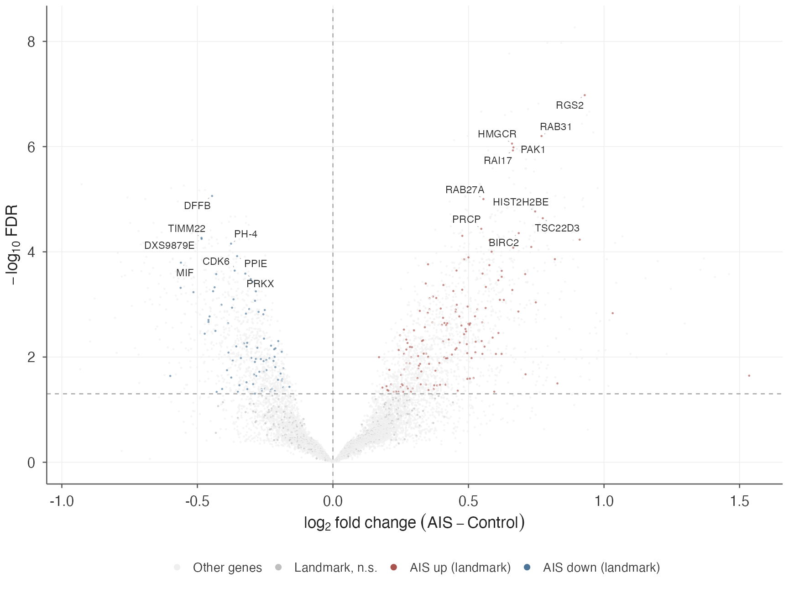
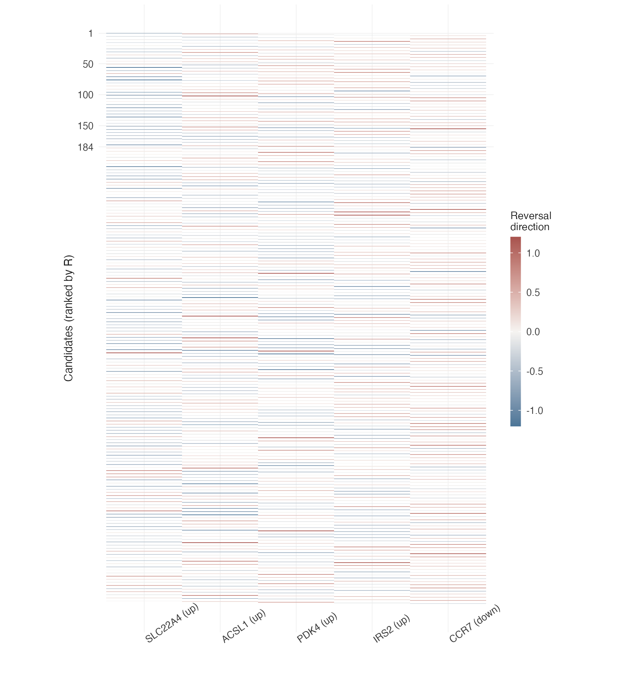

# 缺血性卒中转录组签名驱动的药物重定位

**A reproducible drug-repositioning pipeline for acute ischaemic stroke (AIS), built around frozen analysis rules and honest negative results.**

从公共全血转录组（GSE16561）构建 AIS 疾病表达签名，在 L1000/LINCS 化学扰动图谱中检索"表达方向相反"的化合物，再用患者级重采样、独立队列重算和通路层检验逐项压测这个排名到底站不站得住。

> **一句话结论**：流水线完整跑通，但没有产出可靠的候选药物清单。签名方向稳定而基因名单不稳定（Jaccard 0.06），Top20 候选的排名四分位距达 433/1714，外部队列 ≤3 h 几乎不复现（ρ = −0.039），通路层面无一通过 FDR<0.05。仓库的价值在于**把"为什么不可靠"量化下来**，而不是给出一份看起来漂亮的 Top20。

⚠️ 研究用途的方法学演示，不是临床建议，不构成任何用药推荐。

---

## 目录

- [1. 研究问题](#1-研究问题)
- [2. 关键结果](#2-关键结果)
- [3. 仓库结构](#3-仓库结构)
- [4. 数据来源](#4-数据来源)
- [5. 环境与依赖](#5-环境与依赖)
- [6. 复现步骤](#6-复现步骤)
- [7. 结果文件索引](#7-结果文件索引)
- [8. 图表](#8-图表)
- [9. 为什么每一步都要"先冻结"](#9-为什么每一步都要先冻结)
- [10. 已知限制](#10-已知限制)
- [11. 引用与许可](#11-引用与许可)
- [12. 上传到 GitHub](#12-上传到-github作者操作指引)

---

## 1. 研究问题

急性缺血性卒中（AIS）缺少可用的神经保护药物。转录组层面的"连接图"思路（connectivity map）提供了一个低成本假设生成路径：如果某化合物能把患者外周血里被扰动的基因表达"推回去"，它可能值得进一步研究。

本项目把这条思路拆成四个可证伪的问题：

| # | 问题 | 判定方式 |
|---|---|---|
| Q1 | 能否从全血转录组得到稳定的 AIS 表达签名？ | 患者级 bootstrap 重采样，看基因名单与方向的稳定性 |
| Q2 | 在 L1000 中"反向关联"的化合物排名稳不稳？ | 1,000 轮重采样，报排名区间与 Top20 频率 |
| Q3 | 换一个独立队列重算，排名还在吗？ | GSE58294 ≤3 h 固定规则重算，报秩相关与名次变化 |
| Q4 | AI 扰动预测能否补上缺失的实验特征？ | 预注册门槛：测试集主指标须优于条件均值基线，未过则**不启用**预测分支 |

第 4 问的答案是否定的，因此本仓库所有候选都只基于**实测** L1000 特征，不存在"纯预测"候选。

## 2. 关键结果

| 阶段 | 结果 | 关键数字 | 出处 |
|---|---|---|---|
| 疾病签名 | 18,575 基因受检，FDR<0.05 共 2,464 个 | 签名取上调 100 + 下调 85（下调方向的显著 landmark 只有 85 个，未凑数） | [`docs/02`](docs/02_ais_signature_report.md) |
| 签名稳定性 | **方向稳、名单不稳** | 与主签名 t 值秩相关中位 0.91（200 轮无一轮为负）；但上调组基因 Jaccard 仅 **0.06** | [`docs/05`](docs/05_stability_report.md) |
| 模型门槛 | **未通过**，预测分支不启用 | 测试集逐条件 Spearman：条件均值 0.0917，指纹+岭 0.1078；差值 +0.0163，95% CI **[−0.003, +0.036]** 跨 0 | [`docs/04`](docs/04_model_eval_and_final_ranking.md) |
| 药物排名 | 1,714 个母体化合物，184 个满足候选规则 | 证据分级 A 756 / B 831 / C 127；候选 184 | [`docs/04`](docs/04_model_eval_and_final_ranking.md) |
| 排名稳定性 | 位次大幅漂移 | Top20 的排名 IQR 中位 **433 / 1,714**；单轮 R 与最终 R 秩相关 0.489 | [`docs/05`](docs/05_stability_report.md) |
| 外部重算 | **不复现** | GSE58294 ≤3 h 与发现阶段 R 的秩相关 **−0.039**；Top20 重合 **0/20**；候选名次中位百分位 50.9%（≈随机） | [`docs/06`](docs/06_external_validation_report.md) |
| 五基因解释层 | 全部依赖推断值，方向接近随机 | SLC22A4/ACSL1/PDK4/IRS2 上调、CCR7 下调；五者均不在 978 landmark 内（`pr_is_bing=1`） | [`docs/07`](docs/07_five_gene_pathway_evidence_cards.md) |
| 通路层 | 无可解释信号 | 748 条 Reactome 通路；预注册代谢/免疫池内 **(候选, 通路) 组合无一 FDR<0.05**（最小 0.051） | [`docs/07`](docs/07_five_gene_pathway_evidence_cards.md) |

一个附带的、值得记住的教训：**签名"看起来显著"不等于"可重复使用"**。FDR<0.05 的基因有三千个，|t| 在第 100 名附近极其密集，抽样扰动就足以把前 100 名洗掉 94%。用固定基因名单打分，等于把名单抖动直接传给药物排名。

## 3. 仓库结构

```
.
├── README.md
├── LICENSE                       MIT（代码）
├── CITATION.cff
├── requirements.txt              Python 依赖（仅 AI 分支需要）
│
├── reference/                    不可再生的参考数据（入库，随版本固定）
│   ├── GPL20573_L1000_landmark_table.csv   978 个直接测量的 landmark 基因
│   ├── ReactomePathways.gmt                2,874 条通路定义（2026-10 版本）
│   └── ReactomePathwaysRelation.txt        通路父子关系（首列父、次列子）
│
├── signature/                    冻结的疾病签名与规则（只读）
│   ├── AIS_signature_config.yaml 签名规则，2026-11-09 13:05 冻结
│   ├── drug_ranking_config.yaml  排名规则，2026-11-09 15:20 冻结
│   ├── AIS_screen_signature.csv  185 个筛选签名基因
│   └── AIS_all_genes.csv         18,575 基因的全转录组结果
│
├── metadata/                     样本与化合物身份（入库）
│   ├── sample_manifest.csv       195 样本 / 149 受试者，逐样本 evidence 列
│   ├── compound_identity_parents.csv   按 InChIKey 骨架合并的母体化合物
│   ├── compound_development_status.csv ChEMBL max_phase 注释
│   ├── test_compounds_sealed.csv       冻结的 30% 测试化合物
│   └── landmark_alias_map.csv 等映射表
│
├── scripts/                      R 分析流水线（编号即执行顺序）
├── ai/                           三种扰动预测模型（Python，DeepCE 需另行获取）
│
├── results/
│   ├── tables/                   汇总表（CSV，入库）
│   ├── figures_v2/               最终 18 张图（300 dpi）
│   └── qc/                       逐样本 QC 指标
│
├── docs/                         各阶段技术报告（中文，含方法与数字）
└── data/                         不入库（见 .gitignore）
    ├── raw/      11 GB  原始 GEO / LINCS / Reactome 下载
    ├── parsed/   32 MB  探针级矩阵
    ├── processed/158 MB 基因级矩阵与药物 z 矩阵
    └── pred/     369 MB 模型训练/调参/测试集
```

## 4. 数据来源

**本仓库不包含任何原始数据**，只提供获取脚本与已派生的汇总结果。

| 数据 | 用途 | 访问方式 |
|---|---|---|
| [GSE16561](https://www.ncbi.nlm.nih.gov/geo/query/acc.cgi?acc=GSE16561) | 发现队列：39 AIS / 24 对照，全血，GPL6883 | `scripts/00_fetch_raw_data.sh` |
| [GSE58294](https://www.ncbi.nlm.nih.gov/geo/query/acc.cgi?acc=GSE58294) | 外部重算：23 心源性栓塞 / 23 对照，≤3 h、5 h、24 h 三时点 | 同上 |
| [GSE22255](https://www.ncbi.nlm.nih.gov/geo/query/acc.cgi?acc=GSE22255) | 慢性期补充（≥6 个月 PBMC），**不并入主分析** | 同上 |
| [GSE70138](https://www.ncbi.nlm.nih.gov/geo/query/acc.cgi?acc=GSE70138) | L1000 Level5 COMPZ（CMAP02，化学扰动，5 GB） | `... --with-lincs-level5` |
| [Reactome](https://reactome.org/download-data) | 通路定义与层级 | 已固定副本在 `reference/` |
| [ChEMBL](https://www.ebi.ac.uk/chembl/) | 化合物 max_phase / 上市状态 | 查询结果缓存在 `metadata/` |

几条数据使用约束，写在配置里也写在这里：

- GSE16561 的矩阵**已按基因基线变换为 log2 比值**，不得再 log2；未见批次字段，批次不可校正（记为限制，不假装模型能消除）。
- GSE58294 的 23 例患者各有 3 个时点，共享 `subject_id`；5 h / 24 h 是**治疗后**样本，不是独立队列，只能做时间敏感性。
- L1000 的 978 landmark 是**直接测量**（进主筛选）；其余约 1.1 万基因是模型**推断值**，只在解释层使用，且与药物排名同源，不构成独立验证。
- L1000 的细胞系全部是癌细胞或永生化正常细胞（含 HA1E 正常肾上皮），**没有患者免疫细胞**，因此结论只能表述为"在 X 细胞模型中的表达反向关联"。

原始文件的下载地址与 MD5 校验值见 [`reference/00_raw_data_provenance.md`](reference/00_raw_data_provenance.md)。

## 5. 环境与依赖

- **R 4.5.3**：`limma` `rhdf5` `data.table` `matrixStats` `ggplot2` `ggrepel` `scales` `pheatmap` `clusterProfiler` `fgsea` `org.Hs.eg.db` `AnnotationDbi` `yaml` `digest` `ragg`
- **Python 3.13**：`numpy` `scipy` `scikit-learn` `torch` `rdkit`（仅 `ai/` 与 `scripts/18_featured_targets.py` 需要）
- 硬件备注：DeepCE 训练在 8 核 / 8 GB 无 GPU 环境下不可行（实测 19 分钟/轮且内存线性增长），这是方法学限制的记录，不是性能结论，详见 `ai/output/LOCK.txt`。

```bash
Rscript scripts/00_install_deps.R
python3 -m venv .venv && source .venv/bin/activate && pip install -r requirements.txt
```

### 第三方代码

`ai/` 中的 DeepCE 部分依赖 [pth1993/DeepCE](https://github.com/pth1993/DeepCE)
（Pham TH. *et al.* *Nat Mach Intell* 3:247–257, 2021）。该仓库未声明开源许可，
因此本仓库**不再分发其源码**，需要时自行获取：

```bash
git clone https://github.com/pth1993/DeepCE ai/DeepCE
```

我们的代码只通过 `ai/data_common.py` 的 `sys.path` 引用它的 `models.DeepCE` 与
`utils.molecule_utils`，未改动网络结构；`ai/train_deepce_ais.py` 只替换数据读取与损失权重配置。
方法一（条件均值）与方法二（指纹 + 岭回归）完全自包含，不依赖 DeepCE。

脚本用 `AIS_ROOT` 环境变量定位项目根目录，未设置时自动取脚本所在目录的上一级，**因此在任意路径克隆都能直接跑**：

```bash
git clone <repo-url> && cd <repo-dir>
bash scripts/00_fetch_raw_data.sh --with-lincs-level5
Rscript scripts/01_parse_series_matrix.R
```

## 6. 复现步骤

所有脚本都用 `Rscript scripts/xx.R` 在仓库根目录运行。🔒 标记的文件是**冻结产物**，重跑会覆盖它们——只有在明知要重建整个分析时才该动。

**阶段一 · 数据与签名（分钟级）**

```bash
Rscript scripts/01_parse_series_matrix.R      # GEO series matrix -> 探针级矩阵
Rscript scripts/02_build_sample_manifest.R    # 样本清单（逐样本 evidence）
Rscript scripts/03_preprocess_qc.R            # 注释、log 尺度核查、QC、基因级矩阵
Rscript scripts/04_ais_signature.R            # limma ~group+age+sex -> 🔒 签名
Rscript scripts/05_pathway_composition.R      # GSEA/ORA + 细胞组成诊断
```

**阶段二 · 化合物身份与药物特征（需 LINCS 元数据；第 4 周版本已作废）**

```bash
Rscript scripts/06_compound_identity_split.R  # InChIKey 骨架合并 + 70/15/15 划分
python3  scripts/07_drug_status_chembl.py     # ChEMBL max_phase 注释
Rscript scripts/08_drug_ranking.R             # ⚠️ v1 排名，存在剂量合并错误
Rscript scripts/09_build_pred_dataset.R       # 模型训练/调参/测试矩阵
```

> ⚠️ `08_drug_ranking.R` 的产物是**已作废**的 v1 排名：`dose_used` 在 `(parent, cell)` 组内恒定，导致不同剂量被合并。第 4 周的 451 个化合物 / 37 个候选因此不可用（与最终排名秩相关≈0，Top20 中位位次 1018/1714）。保留脚本是为了留下修正记录，**不要在它之上继续分析**。

**阶段三 · 最终排名（重算 z 矩阵，内存吃紧）**

```bash
Rscript scripts/10_build_drug_zmatrix.R       # 一次性 h5read 全行子集 -> 949×30,932
Rscript scripts/11_final_drug_ranking.R       # 🔒 1,714 化合物 / 184 候选
cat ai/output/LOCK.txt                        # 模型锁定记录（测试集解封前置条件）
python3 ai/evaluate_test.py                   # 🔒 门槛判定（未通过 -> 不启用预测）
```

**阶段四 · 压测（小时级，重采样最慢）**

```bash
Rscript scripts/12_stability_resampling.R     # 1,000 轮患者级 bootstrap（最慢）
Rscript scripts/15_stability_summary.R        # 排名区间 + 双分母频率
Rscript scripts/13_condition_sensitivity.R    # 基因数/细胞背景/剂量/时间/组成调整
Rscript scripts/14_external_validation.R      # GSE58294 固定规则重算
Rscript scripts/16_five_gene_coverage.R       # 五基因覆盖 + 方向
Rscript scripts/17_pathway_direction.R        # Reactome 竞争性检验（置换 p）
python3  scripts/18_featured_targets.py       # 重点候选证据汇总
Rscript scripts/19_redraw_figures.R           # 按统一规范重绘 18 张图
```

关键代价：`10` 必须一次性读入 30,932 列子集，分块会累积内存被系统杀掉；`12` 每轮都要重建签名并重算 949×1,714 的相关，1,000 轮需要数小时。

## 7. 结果文件索引

| 文件 | 内容 |
|---|---|
| `results/tables/final_drug_ranking_all.csv` | 1,714 个化合物的最终 R、细胞间范围、应激标记、证据分级 |
| `results/tables/final_candidates_measured.csv` | 184 个候选（全部基于实测特征），含 `max_phase`、排名、是否超过 null |
| `results/tables/final_candidates_predicted.csv` | **仅含表头**——预测分支未启用，这是有意的空白 |
| `results/tables/stability_rank_intervals.csv` | 每个化合物的 1,000 轮排名区间与 Top20 频率（两个分母并列） |
| `results/tables/stability_round_log.csv` | 逐轮记录：显著基因数、签名规模、是否信息不足 |
| `results/tables/sensitivity_*.csv` | 签名规模 50/100/150、`t`/`logFC`、细胞对、剂量层、时间层、组成调整 |
| `results/tables/external_*.csv` | GSE58294 三个时点的秩相关、候选名次变化、共同基因空间 |
| `results/tables/five_gene_*.csv` | 五基因覆盖表、条件级方向明细、候选×基因汇总 |
| `results/tables/pathway_drug_candidates.csv` | 137,632 行（184 候选 × 748 通路），三层 FDR（类别内 / 预注册池 / 全库） |
| `results/tables/pathway_agreement_summary.csv` | 每通路的疾病 z、反向候选比例 |
| `results/tables/single_condition_reversal.csv` | 仅在单一条件出现反向关系的条目（明确标注，不当作一致证据） |
| `results/tables/top20_display_analysis_*.csv` | Top20 的展示分析（A 固定条件 / B 共同面板） |

所有表格里的 `R` 都是 **R = −Spearman(AIS 签名 t, 药物 z)**，不是官方 tau，不是疗效概率，只表示表达方向的反向关联强度。负相关本身不保证符号逆转，所以每张表同时给了符号一致比例。

## 8. 图表

最终图在 `results/figures_v2/`，共 18 张：三队列 QC × 4（PCA / 箱线 / 密度 / 样本相关）、签名层 4 张（火山图、签名得分、GSEA、细胞组成）、解释层 2 张（五基因热图、通路热图）。





统一规范（[`docs/08_figure_spec.md`](docs/08_figure_spec.md)）：画布宽 5.8 in = A4 正文宽，300 dpi，Helvetica 8.5 pt，全英文标注、无图内标题，暖 `#A8534E` / 冷 `#4C7597` 低饱和配色，窄图左右留白补足画布以保持字号比例。

## 9. 为什么每一步都要"先冻结"

这套流水线里最容易被忽略、但对结论可信度影响最大的部分，是**时点**：

| 冻结内容 | 冻结时间 | 在什么之前 |
|---|---|---|
| 签名规则（FDR<0.05、按 \|t\| 排序、每方向至多 100、少于 10 记"信息不足"） | 2026-11-09 13:05 | **任何**药物排名计算 |
| 排名规则（R 定义、候选三条判据、7 细胞面板、10 µM/24 h 主条件） | 2026-11-09 15:20 | 查看任何药物-AIS 相关性 |
| 化合物 70/15/15 划分（母体化合物为单位） | 排名前 | 训练/调参之前 |
| 模型超参数与锁定哈希 | 2026-11-09 21:17 | 测试标签解封之前 |
| 外部验证要素（基因列表、药物集合、缺失基因处理、计分方式） | GSE58294 表达值读取之前 | 重算之前 |

三个可以直接检查的产物：`signature/*.yaml`（规则 + 冻结时间戳）、`ai/output/LOCK.txt`（超参数与 sha256）、`metadata/test_compounds_sealed.csv`（封存的测试化合物）。`evaluate_test.py` 在缺少 `LOCK.txt` 时会拒绝运行。

这些文件同时也是**审计线索**：如果某个数字对不上，先看是不是规则被改过。

## 10. 已知限制

1. **单队列发现**：只有 GSE16561（n=63），没有未接触过的独立验证集。GSE58294 已用于前期研究，只能称"外部队列重复性评估"。
2. **全血 bulk**：签名可能主要反映白细胞比例差异。做了组成调整敏感性分析，但那只检验"排名是否依赖细胞比例"，**不能证明药物改变了细胞比例**。
3. **细胞模型错配**：L1000 的 7 个核心细胞系与卒中患者的免疫细胞无关，任何结论都限于"该细胞模型中的表达反向关联"。
4. **证据等级不均**：五基因解释层全部基于 bing 推断值，强度低于候选排名（后者至少用 landmark 实测值）。
5. **R 的含义有限**：不是 tau，不是疗效，不校正暴露/毒性。高 `r_consensus` 与强效应标记（`any_stress`、`any_strong_effect`）只作为解释字段，不用于推荐。
6. **DeepCE 未完成**：算力不足，未产出权重，也未用"只训 3-5 轮"的替代方案充数。三方法比较因此只完成两种。
7. **通路层无显著结果**：预注册池内最小 FDR 0.051，全库探索性条目（Cell Cycle、DNA 修复）多为一般抗增殖特征，不作机制解释。
8. **排名本身不稳**：Top20 的 IQR 达 433/1714，任何"第 N 名"的表述都应同时给出区间。

## 11. 引用与许可

- **代码**：MIT，见 [`LICENSE`](LICENSE)。
- **原始数据**：版权与使用条款归各数据源（GEO / Broad LINCS / Reactome / ChEMBL），本仓库不再分发，请通过 `scripts/00_fetch_raw_data.sh` 自行获取并遵守其条款。
- **引用**：`.cff` 元数据见 [`CITATION.cff`](CITATION.cff)（作者信息请替换为实际署名）。若引用本仓库的方法设计，请同时引用上述数据源。

各阶段完整方法与数字见 `docs/01`–`docs/07`；图表规范见 `docs/08`。

---

## 12. 上传到 GitHub（作者操作指引）

仓库已初始化为 git 仓库并完成首次提交，目录里不含大数据（`data/` 已在 `.gitignore` 中）。
把下面的 `<你的账号>` 与 `<repo-name>` 换掉即可：

```bash
# 1) 在 GitHub 网页新建空仓库（不要勾选 README / .gitignore / license）
git remote add origin https://github.com/<你的账号>/<repo-name>.git

# 2) 推送
git branch -M main
git push -u origin main
```

推送前请确认三处署名，避免公开仓库里留占位符：

- `LICENSE` 第 3 行的版权人
- `CITATION.cff` 的 `family-names` / `given-names` / `repository-code`
- 若课程要求匿名评审，把这三处改成课程编号或删除 `CITATION.cff`

仓库体积约 45 MB（主要是 `results/tables/pathway_drug_candidates.csv` 28 MB
与 18 张 300 dpi 图）。若想更小，可在 `.gitignore` 里加
`results/tables/pathway_drug_candidates.csv`，结论不受影响——该表的汇总结果已由
`pathway_agreement_summary.csv` 与 `docs/07` 承载。
